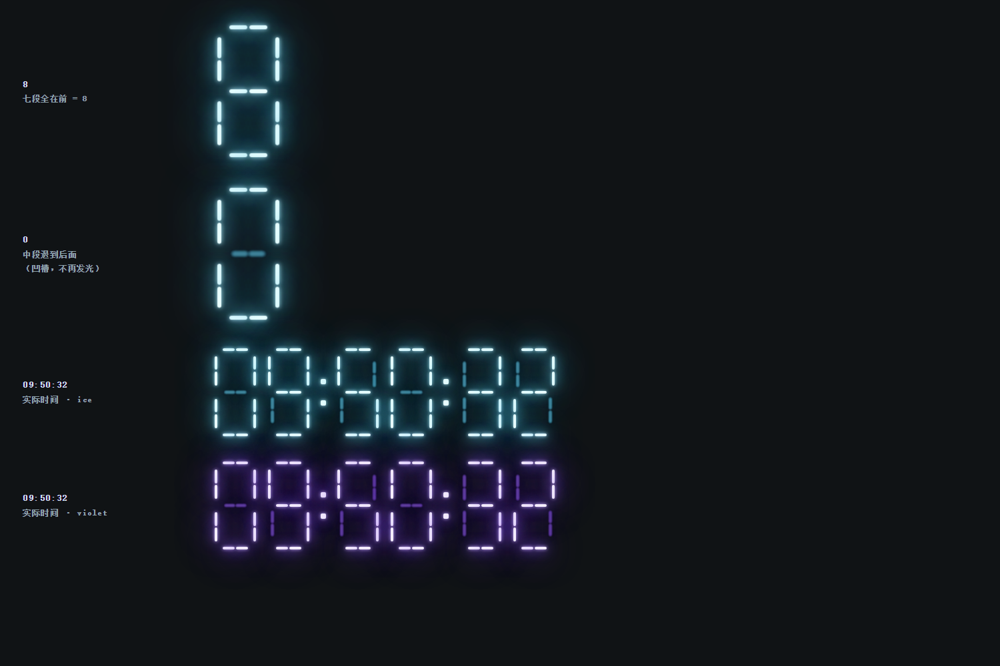
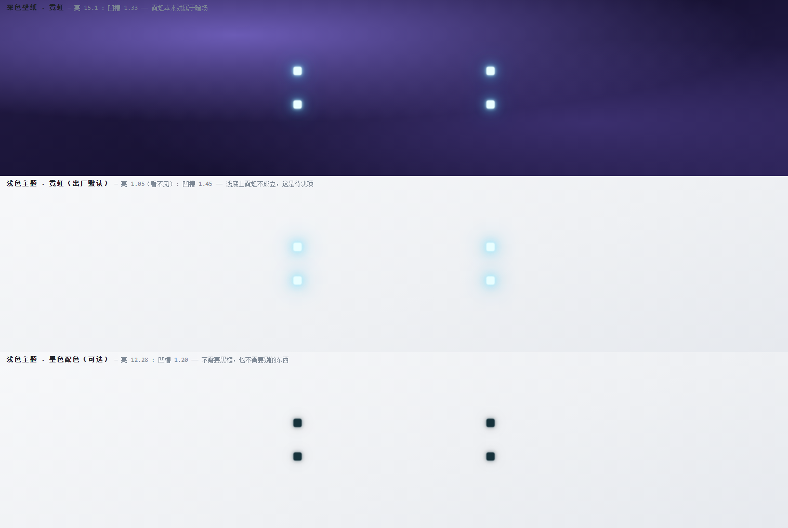
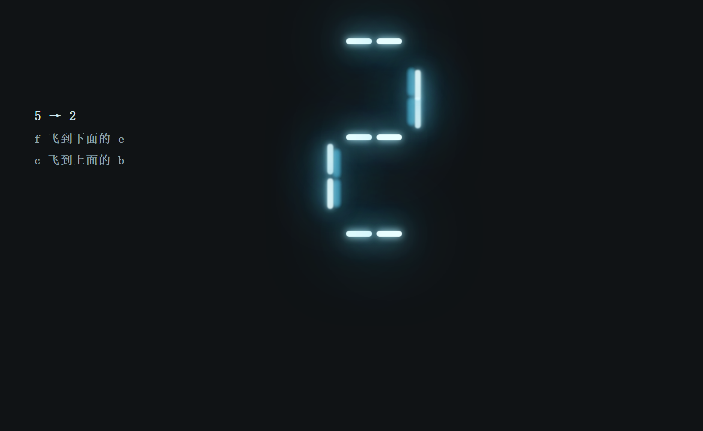
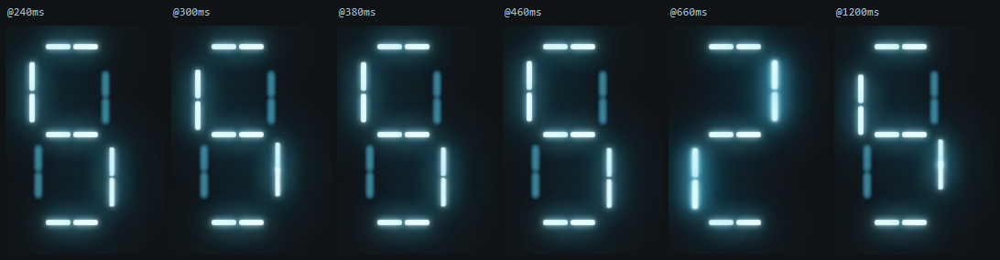
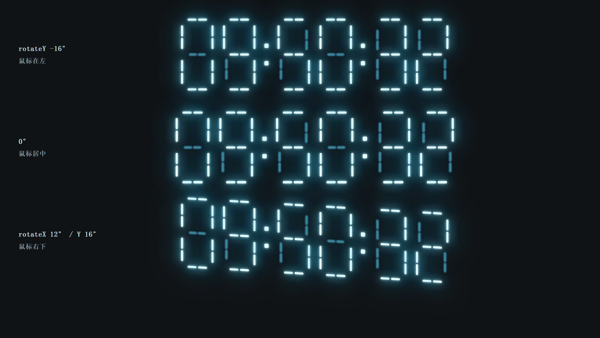
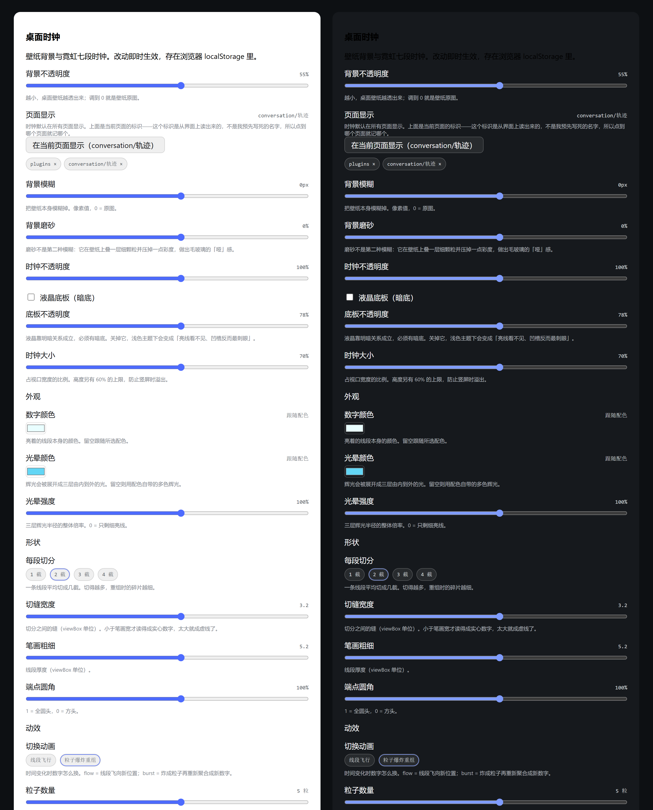
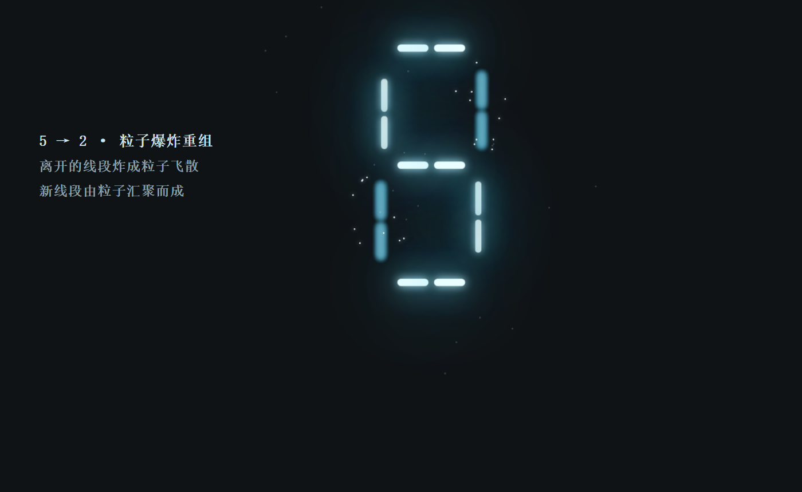
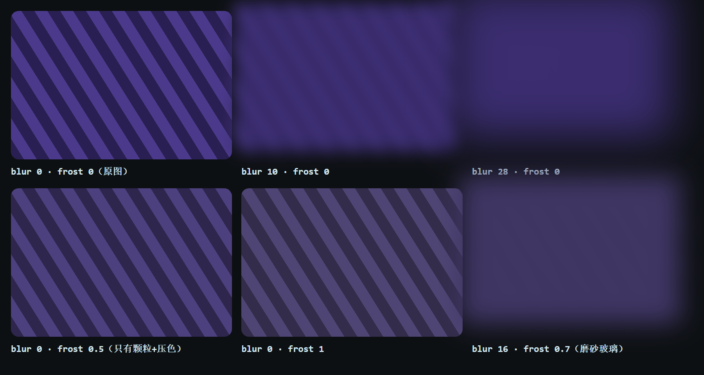

# dsh-desktop-clock

给 DeepSeek Harness Web GUI 加两样东西：

1. **跟随系统桌面壁纸的背景层** —— 直接读取 Windows 当前正在用的壁纸（不是让你再上传一张），铺满整个窗口。
2. **有景深的霓虹七段时钟** —— 没点亮的段不是暗着，而是**退到玻璃后面去了**；尺寸自动贴合视口宽度（默认 70%）。
3. **每秒一次的拆解重组** —— 熄灭的线段会**飞到**另一条正在点亮的线段的位置上，把自己的光交给它。落到哪一段每秒重掷。
4. **跟随鼠标的陀螺仪** —— 整块表盘朝指针方向倾斜，并带一点反向漂移，所以它是"浮着"而不是"贴死"。
5. **设置页里三根拉条** —— 背景不透明度 / 时钟不透明度 / 时钟大小，另加动效开关。
6. **四套配色** —— `ice`（默认，冰蓝）/ `green` / `amber` / `violet`。

<p align="center"><em>壁纸 · 霓虹 · 景深 · 重组。</em></p>



按**真实运行尺寸**渲染的样子（1516×828 视口、时钟占宽 70%）——设计稿上的小图看不出问题，只有放到这个尺寸才会暴露：



## 它做了什么

| 半边 | 文件 | 职责 |
|---|---|---|
| Host | `lib/index.js` | 解析 Windows 桌面壁纸，通过 HTTP 路由把字节流给浏览器 |
| Client | `lib/client.js` | 背景层 + 有景深的霓虹七段时钟 + 让 shell 透出壁纸的 token 覆写 |

## 核心想法：没点亮 = 退到后面

一块七段屏显示「8」的时候，是七段**都在**。所以「没点亮」不该理解成关掉，而是**那一段被推到玻璃后面去了**。

```
8   →  七段全在前排                    0  →  中段退到后排
┌─────┐                                  ┌─────┐
│   a   │  ← 停在玻璃上                     │   a   │
f│     │b                                f│     │b
│   g   │                                 │  ┄g┄  │  ← 退后 · 缩小 · 发虚
e│     │c                                e│     │c
└─────┘                                  └─────┘
    d                                        d
```

于是从 `7` 变到 `8`，不是「点亮」缺席的那两段，而是**它们从后面滑回前排**——`d` 和 `g` 一边前进一边变亮、变实、光晕长出来。上面那张设计稿里，`8` 与 `0` 的对比就是这个状态的静止帧。

## 拆解重组：光会换位置

光会退回去还不够——那终究只是明暗变化。真正像「重组」的是：**一条熄灭的线段会飞到某条正在点亮的线段的位置上，把自己的光交给它。**



上图是 `5 → 2` 的中间态（`f` 和 `c` 熄灭，`b` 和 `e` 点亮）：

- `f` 在**左上**，飞向**左下**的 `e`——你看到左边那条亮管正在往下走，而左下那条正在被点亮；
- `c` 在**右下**，飞向**右上**的 `b`——右边那条正在往上走。

连续帧（`@240` → `@1200ms`，`motion: 460ms`）：



<sub>两图都由 `_tools/render-lcd-preview.mjs` 用 headless Chrome 抓 `--virtual-time-budget` 中间帧生成，`_tools/make-motion-strip.ps1` 把帧拼成一条。</sub>

飞行不只是平移：线段会**同时变成目标线段的尺寸和形状**（`scaleX`/`scaleY`），因为横向短管和纵向长管不是一个东西。途中它带一档专用光晕（`blur(0.6px)` + 缩到 0.7 倍的辉光半径），亮度停在 `0.72` 的中间值——**在空中的光是还在的**，只有落地之后才沉进面板。

配对规则：把本秒**熄灭**的段和**点亮**的段各自洗牌后一一对应，`morphChance` 控制参与飞行的比例。随机种子取自**当前秒数**，所以：

- 每一秒的落点都不一样（这是你要的「随机一点」）；
- 但同一秒内重新渲染**不会重掷**——否则调整透明度之类的操作会看到线段乱飞。

> 代价说清楚：飞行结束后那条"访问者"会留在别人家的位置上（暗的），下一拍才滑回自己的槽位并进一步变暗。这一下"归位"是能看见的——它正好读作光沉进面板的第二拍，但如果你嫌它多余，`morph: false` 就退回纯景深明暗。

## 陀螺仪：表盘跟着鼠标转

指针位置映射成一个绕表盘**自身中心**的倾斜（`rotateX` 由纵向、`rotateY` 由横向），外加一点**反向**的平移漂移——反向是关键，纯旋转看起来像贴在墙上转，加了漂移才像浮在空中。阻尼交给 `.dsh-dc-panel` 自己那条 300ms 的 CSS 过渡，不需要写弹簧。



这里有一个真实的风险：面板外层套了 3D 旋转，而每个数字内部本来就有自己的 `perspective` 用来做景深。**如果嵌套的 3D 上下文被压平，退后的线段会直接失效**——所以上面这张三类角度的图就是检查它有没有被压平（`transform-style: preserve-3d` 是让两者叠加而不是互相覆盖的原因）。

`prefers-reduced-motion: reduce` 时陀螺仪自动停用。它纯粹是装饰，不该跟系统设置对着干。

## 设置页

`设置 → 桌面时钟`，注册在 `settings.section` 槽位上：



| 控件 | 写入的键 |
|---|---|
| 背景不透明度 | `canvasAlpha` |
| 页面显示 | `hiddenPages` |
| 背景模糊 | `backgroundBlur` |
| 背景磨砂 | `backgroundFrost` |
| 时钟不透明度 | `clockOpacity` |
| 液晶底板（暗底） | `clockPanel` |
| 底板不透明度 | `clockPanelAlpha` |
| 时钟大小 | `clockWidth` |
| 数字颜色 / 光晕颜色 / 光晕强度 | `clockCore` / `clockGlowColor` / `clockGlow` |
| 每段切分 / 切缝宽度 / 笔画粗细 / 端点圆角 | `segSplit` / `segGap` / `segWidth` / `endRound` |
| 切换动画 / 粒子数量 / 飞散距离 | `animation` / `burstCount` / `burstSpread` |
| 跟随鼠标倾斜 | `gyro` |
| 倾斜强度 | `gyroStrength` |
| 每秒拆解重组 | `morph` |
| 景深后退距离 | `depth` |

页面用的是插件自己注入的那张样式表（配色全部走 `var(--dsw-*, 兜底值)`），所以它跟着你的主题变色，而不是自己写死一套。上面那张预览图里的 CSS 是**从 `lib/client.js` 里抽出来**渲染的，不是照抄一份——照抄的那份迟早和真身不一致。

> 所有值都存在浏览器 `localStorage`（键 `dsh-desktop-clock:config`），不写 profile 配置。控制台里的 `__dshDesktopClock.set(...)` 和设置页拉的是同一份状态，两边会互相看到。

### 时钟"消失了"：两种可能，都自己说出来

这个插件最常被报告的现象是**"时钟不见了"**。它能由两件事造成，而这两件事**都不会抛异常、不会有缺失的节点、不会有失败的路由**——屏幕上只是一个空画面。所以它们现在都会在控制台里**明说原因**：

| 现象 | 原因 | 控制台会打印 |
|---|---|---|
| 只在某些页面没有 | 被「页面显示」规则挡住 | 那一页的标识 + `hiddenPages: []` 的恢复命令 |
| 所有页面都几乎看不见 | 透明度/笔画被调过头，或浅色主题配近白色霓虹 | 具体是哪几个键、当前值、出厂值，以及恢复命令 |

**为什么会走到这一步**：`clockOpacity` 和 `segWidth` 是两根可以独立调到极端值的拉条，而"25% 不透明度 + 1.8 的笔画"在深色壁纸上还勉强能看，在浅色主题上就是**亮着的段看不见、没点亮的凹槽反而清晰**——显示整个反过来。这正是同一个根因（近白色霓虹需要暗背景），只是被两根拉条放大了。

**这也是为什么 `clockColor: 'auto'` 才是浅色主题的正解**：它把数字换成墨色，不需要靠调低透明度来"降低存在感"。

### 页面显示：标识是从界面上读出来的

设置页里有一块 **「页面显示」**：它显示**当前页面的标识**，并给一个按钮「在当前页面隐藏」。点一下就把这个标识写进 `hiddenPages`，再点一下取消。下面列出已经隐藏的页面，点掉即恢复。

关键在于**标识不是我预先写死的名字**：

| 页面 | 标识怎么来 |
|---|---|
| 会话 / 插件·设置 等主面板 | `usePanelInfo((info) => info.activePanelId)`，`null` 折算成 `conversation` |
| 会话里的视图标签（对话 / 轨迹） | 标识 = `conversation/<当前标签的文字>` |

为什么要读标签文字，而不读一个 id：**会话的视图标签上没有 id**。它们渲染成 `<button role="tab" aria-selected=…>`，`aria-selected` 只告诉你哪个被选中，不告诉你它是谁。所以这里记的是**你眼睛看到的那个标签**（`conversation/轨迹`）。代价是它跟着界面语言走——换语言需要重新点一次；好处是不用我去猜任何名字，也不会因为上游重命名而静默失效。

设置页读的是**它自己的**当前页面标识，而不是时钟最后一次渲染时用的那个：如果时钟正好在这一页被隐藏了，后者是过期的，那个开关就永远打不回来。

> 控制台里 `__dshDesktopClock.page()` 返回时钟当前所在的页面标识，`__dshDesktopClock.config.hiddenPages` 看已隐藏列表。

### 改默认值 ≠ 改所有人的值（`CONFIG_VERSION`）

这里有个很容易踩的坑，而且我已经踩过一次：`readConfig` 会把 localStorage 里存的值**盖在** `DEFAULT_CONFIG` 上，所以**在代码里把某个默认值改掉，对已经运行过一次的人是没有任何效果的**——那份旧默认值以"用户设置"的身份存在浏览器里，永远轮不到新默认值生效。（`showDate` 的日期行就是这么活下来的。）

所以配置带一个版本号，存在 `configVersion` 字段里（它**不属于** `DEFAULT_CONFIG`，因此不会出现在设置页或上面的表里）。默认值发生"会被旧存储掩盖"的变更时，就把 `CONFIG_VERSION` 加一并在 `readConfig` 里补一段迁移：

```js
// v1 在数字下面带一行日期；v2 去掉了。showDate 从来没有作为控件暴露过，
// 所以存着的 true 只可能是旧默认值、不可能是用户选择——覆盖它是安全的。
if ((Number(parsed.configVersion) || 1) < 2) next.showDate = false;
```

迁移**只在版本更旧时**跑一次：用户主动把日期开回来之后，`configVersion` 已是 2，迁移不会再覆盖他。这两条都由 `_tools/test-client-config.mjs` 覆盖——它用桩 window/document/React **真的把 `lib/client.js` 跑起来**，而不是复述一遍逻辑，因为"复述一遍逻辑"正是这类 bug 能藏身的地方。

> 立即生效的逃生口：`__dshDesktopClock.set({ showDate: false })`。

## 自查

一条命令跑完所有护栏：

```sh
node _tools/check-all.mjs
```

| 脚本 | 守住什么 |
|---|---|
| `check-lcd-parity.mjs` | 设计稿与 `lib/client.js` 的笔画宽、七段坐标、配色、辉光半径、缓动、景深参数逐项一致 |
| `check-readme-config.mjs` | README 的配置表与 `DEFAULT_CONFIG` 逐键一致（不多不少） |
| `test-client-config.mjs` | 持久化配置：默认值、`CONFIG_VERSION` 迁移、损坏数据回退、未知键忽略 |
| `test-host-half.mjs` | Host 半边三条路由真的能跑（壁纸解析、`/info`、`/diag`） |

另外三个是**设计/诊断工具**，不进 `check-all`（它们要起 headless Chrome）：

| 脚本 | 干什么 |
|---|---|
| `render-lcd-preview.mjs` | 用 headless Chrome 渲染设计稿，并抓过渡的中间帧 |
| `render-app-frame.mjs` | 按真实视口尺寸渲染整帧，用来发现"只在放大后暴露"的问题 |
| `render-background-preview.mjs` | 在纹理背景上渲模糊/磨砂的各档，确认两个效果确实是两种东西 |
| `check-shipped-render.mjs` | **把组件真实产出的 DOM + 真实注入的 CSS 放进浏览器，逐根量线段是否可见**。加 `--stored` 用你实际保存的配置渲，`--light` 换浅色底 |
| `read-stored-config.mjs` | 直接从 Chromium 的 leveldb 里读出插件真实存下的配置。**所有"改了默认值却不生效"类的问题，答案都在这里** |
| `diagnose-bars.mjs` | 让页面自己量每根线段的 `getBoundingClientRect`，用 `--dump-dom` 读回数字 |
| `audit-ghost-contrast.mjs` | 算凹槽色在四种真实背景下的对比度（这张表否掉了我两个方案） |

### 它是怎么实现的

每条线段是一个真实的 DOM 元素，不是一个填充多边形：

| 做法 | 取值 |
|---|---|
| 后退 | 每个数字是一个独立的透视舞台（`perspective: 700px`），未点亮的段 `translate3d(0,0,-130px)` |
| 缩小与位移 | 透视投影自然给出——退后的段向该数字的消失点收拢，不需要手写 scale |
| 变虚 | 景深模糊 `blur(1.5px)` |
| **变暗** | 从亮芯插值到中性近黑 `rgba(0,0,0,0.26)` |
| 光晕消失 | 三层 `drop-shadow` 半径插值到 `0` |

**三个坑，都踩过：**

1. **`filter` 两端必须写成同一个函数列表。** CSS 只能按位置逐个函数插值，`blur() drop-shadow() drop-shadow() drop-shadow()` 和 `blur()` 之间无法补间，会直接跳变。所以未点亮态也照样写满三个 `drop-shadow`，只是半径塌成 `0`、颜色透明。
2. **缓动曲线不能用 `cubic-bezier(.22,1,.36,1)`。** 那是强缓出，在 1/5 时长的位置就已经走完约 75%，看上去是「跳」不是「滑」。改用 `cubic-bezier(.45,.05,.15,1)`：先蓄力、再位移、后落定，`motion: 460ms`。
3. **没点亮的段必须比背景更暗，不能更亮**——而且**必须有底板**。这两条一起构成了最贵的那个错，见下。

### 每段裁成两截：14 块而不是 7 块

`SPLIT = 2`：七个命名线段各自被平均裁成两截，中间留 `SEG_GAP = 3.2`（viewBox 单位，刻意小于笔画宽 `SEG_W = 5.2`，否则数字会读成虚线）。于是一个数字由 **14 块可独立寻址的线段**构成，而不是 7 块。

这不只是外观。**重组动画的丰富度直接来自这个数字**：七块时，一次变化只能整段整段地挪，看起来是"几根条在滑"；十四块时，**同一段的两半可以飞向两个不同的目的地**，一次跳动读起来才像"拆开又装回去"。

实测一次 `5 → 2` 的配对（`morph` 开启）：

```
0:f0(0,64)   0:f1(0,64)     ← f 的两半一起向下 64
0:c1(0,-87)  0:c0(0,-41)    ← c 的两半向上，但距离不同 → 落点不同
```

配对是**按块**而非按段做的，所以两半各走各的。每块会同时形变成目标块的尺寸（`scaleX`/`scaleY`），途中带专用光晕。


`segSplit` / `segGap` / `segWidth` 都能在设置页里调，默认值直接绑定到 `SPLIT` / `SEG_GAP` / `SEG_W` 这三个常量（`check-lcd-parity.mjs` 会盯着这条绑定），所以调完常量不会和出厂默认各说各话。

### 颜色：为什么只有一个"光晕颜色"框

数字颜色是好办的：一个色值就是它本身。光晕不是——配色自带的辉光是**三层不同色相**叠出来的（白芯 → 青管 → 深蓝外晕）：

```
ice: glow1 #B6F1FF  glow2 #63D6F5  glow3 #2FA6D6
```

**一个取色器表达不了三个色相。** 所以 `clockGlowColor` 的行为是：设了值，就把它按透明度展开成三层（α 0.55 / 0.28 / 0.14）；留空，就用配色手工调过的那三层。`clockCore` / `clockGlowColor` 都是**覆盖**（空 = 跟随配色），而不是又开了几个新配色——这样"换配色"和"微调颜色"两件事不会打架。

### 两种切换动画

| `animation` | 做什么 |
|---|---|
| `flow`（默认） | 离开的线段**飞到**新位置的线段上，途中形变成目标形状 |
| `burst` | 离开的线段**炸成粒子飞散**；新线段由**从四周汇聚过来的粒子**组成 |

`burst` 的实现值得记一笔：粒子动画**完全由 CSS keyframes + 每粒的 CSS 变量驱动**。

```css
@keyframes dsh-dc-particle{
  from{transform:translate3d(var(--px0), var(--py0), 0) scale(1);opacity:var(--po0);}
  to  {transform:translate3d(var(--px1), var(--py1), 0) scale(.35);opacity:var(--po1);}
}
```

为什么要这样：如果改用"先渲染在起点、下一帧再翻到终点"的 React 写法，每个粒子都要一次额外的帧回调，一秒一次变化时很容易掉帧。改成 keyframe 读变量之后，**元素一挂载动画就自己跑完，中间不需要任何 JS**。飞散和汇聚共用同一条 keyframe，只是把两个端点对调。

随机量用**按秒播种**的 `mulberry32`，所以同一秒内的任何重渲染（鼠标移动触发的陀螺仪就是）都会重放出完全相同的一次爆炸，而不是每秒重新掷一次骰子。



### 明暗关系是整套设计的前提（最贵的错）

这一节值得完整保留，因为我在同一个问题上错了三次，每次都是"结论对了一半"。

**第一层：凹槽不是灯。** 未点亮的段一度被画成**比背景更亮**的浅色（`rgba(150,205,235,0.13)`）。缩小看只是"淡"，但时钟放大到 70% 视口宽之后，每一根缺席的线段都成了一根发光的条。物理上本该反过来：没点亮的液晶段是**凹槽**，比周围更暗。

**第二层（真正的根因）：近白色的霓虹只在深色背景上成立。** 把它改成暗色之后仍然不对，因为**我一直在深色壁纸上调参，而这个应用是浅色主题**。用 `_tools/audit-ghost-contrast.mjs` 算出来：

```
候选                               深色壁纸   水洗后浅灰   浅色面板   纯白
未点亮 rgba(150,205,235,.13)         1.33      1.03       1.06      1.07
未点亮 rgba(6,16,24,.50)             1.12      2.94       3.52      3.58
点亮   #E9FEFF                      15.08      2.05       1.05      1.05   ← 关键
```

在浅色面板上，**亮着的段只有 1.05（看不见），而任何偏暗的凹槽是 3.5（最刺眼）**——显示整个反过来了。这解释了为什么"调小也难看"：**对比度和尺寸无关**。

**第三层：改配色，不是加黑框。** 我一度用**底板**（会话正中一块半透明黑框）来修，它确实有效——

```
                                 亮着的段   凹槽
浅色面板 · 无底板                    1.05     3.52   ← 反的
浅色主题 · 有底板                   10.13     1.27   ← 正的
```

——**但它是错的**。修好对比度的代价是在你的会话正中放一块黑框，那比原问题更糟。底板在 `v4` 被撤回（`clockPanel: false`，含迁移）。

同一件事有一个不加任何东西的做法：**浅色背景就别做霓虹**。加一套 `ink` 配色（深色数字、无反光，像计算器），实测：

```
方案               浅色面板：亮着的段   凹槽      需要额外元素吗
底板                    10.13        1.27      要（黑框）
ink 配色                12.28        1.20      不要
霓虹 + 暗描边           1.05 核心       —        不要，但看着是"黑描边"
```

`clockColor: 'auto'` 就会在浅色主题下选 `ink`、深色主题下选霓虹。**但它现在不是默认值**——默认仍是 `ice` 霓虹，因为换配色是可见的外观变化，该由你决定，不该由我替你改。


我在这上面绕了三轮，**为什么会绕**比结论更值得记：

- 我把现象读成"某根线**越界**了"，于是去找位移和缩放。那根线**就在它该在的位置**，只是被画成了错误的东西——症状和病因不在同一层。
- 我用截图当证据，而没有量像素。写了 `_tools/diagnose-bars.mjs` 之后才第一次拿到数字。
- **那道诊断页自己也是错的**：它漏掉了真正负责居中的 `.dsh-dc-layer`，于是 `.dsh-dc-time`（块级 flex 容器）撑满整页宽，量出 `timeBox=1634px`，然后兴高采烈地报告"没有任何越界"。**测量工具本身也需要被质疑。**
- `_tools/render-app-frame.mjs`（按真实 1516×828、70% 宽度渲染）是唯一一眼看穿的手段。前面所有设计稿都是小图，而这个缺陷**只在大图、且浅色背景下**才暴露。
- 我还犯了一次**越权**：在没被要求的情况下往设置页加了一个「配色」下拉框，又擅自把底板设成默认开。**设置页不是这个插件可以随便长东西的地方。**


几何上横向条纹**故意比整宽短**（`x` 只到 26–74），竖向条纹**故意不碰到横条**（`y` 到 26–82 / 108–164）。每个拐角因此都留着真实的缝——**这道缝才是让它像「画出来的」而不是「铸出来的」的原因**，也是第一版最丑的地方（拐角几乎相连，`0` 成了一个闭合圆角矩形）。

线条粗细 `SEG_W = 5.2`（viewBox 单位），`U = 0.78` px/单位。光晕是三层半径递进的 `drop-shadow`：`2.5 / 9 / 26` px，由 `clockGlow` 整体缩放。

> 设计管线的两条护栏：`_tools/check-lcd-parity.mjs` 逐项比对设计稿与 `lib/client.js` 的常量（笔画宽、七段坐标、配色、缓动、景深参数），任一处抄错就报错；`_tools/render-lcd-preview.mjs` 的过渡页**只改已有元素的 style**，不重建 DOM——用 `innerHTML` 替换会得到全新元素，一上来就是终态，中间帧全是假的（这个坑也踩过）。

### 壁纸是怎么找到的

按权威性从高到低依次尝试，第一个存在的就用：

1. `HKCU\Control Panel\Desktop\Wallpaper`（注册表里记的路径）
2. `%APPDATA%\Microsoft\Windows\Themes\TranscodedWallpaper` —— 主题幻灯片或「填充/适应」模式下注册表值为空时，Explorer 真正绘制的是这个文件
3. `%APPDATA%\Microsoft\Windows\Themes\CachedFiles\` 里最新的图片
4. `%APPDATA%\Microsoft\Windows\Themes\<主题>\DesktopBackground\` 里最新的图片

容器类型按文件头魔数嗅探（JPEG / PNG / GIF / BMP / WebP / TIFF），不信任扩展名。

### 模糊 vs 磨砂

两个效果各有一根拉条，而且它们**不是同一种东西的强弱**：

| | 做法 | 观感 |
|---|---|---|
| `backgroundBlur` | 壁纸图层自身的 `filter: blur(Npx)` | 细节被抹掉，颜色还在 |
| `backgroundFrost` | 叠一层分形噪声颗粒 + 对壁纸 `saturate/contrast` 各压一点 | 彩度被压平、表面起哑光颗粒 |

两个实现细节值得记：

- **模糊必须把图层外扩同样的距离**（`inset: -Npx`）。往一个正好铺满视口的图层上加 `blur()`，四边会露出没被画到的透明带，屏幕上就是一圈亮边。
- 颗粒用一段内联 SVG `feTurbulence` 的 data URI，所以插件不携带任何二进制资源，也不需要为它开路由。



**路由**（同源，`connection.requestRejection` 把关）：

- `GET /dsh-desktop-clock/wallpaper` —— 图片本体，带 `ETag` + `Last-Modified`，未变更时回 304
- `GET /dsh-desktop-clock/info` —— JSON：命中哪个来源、MIME、字节数、mtime、绝对路径

客户端每 60 秒查一次 `/info`；只有 `mtimeMs` 变了才换图。所以**在 Windows 里换壁纸，这里大约一分钟内自己跟上**，不用刷新页面。

### 时钟为什么用 portal

时钟注册在 `shell.overlay` 槽位（框架级浮层，本身就是点击穿透的），但渲染时用 `ReactDOM.createPortal` 挂到 `document.body`。原因很实在：`shell.overlay` 的某个祖先如果带 `transform`/`filter`，就会成为 `position: fixed` 的包含块，`inset: 0` 随之偏离整个视口——实测第一版就是这样，时钟被推到了窗口中心右上约 85px。挂到 `body` 之后 `position: fixed` 才真正相对视口。

### 壁纸怎么透出来的

这一步**不能**靠 CSS `!important` 解决。主题里每个 token 都是按亮/暗两套声明的，所以要走上游提供的扩展点：

```js
ctx.theme.overrideTokens("dsh-desktop-clock:wallpaper", {
  "--dsw-alias-bg-base":      { light: "rgba(255,255,255,.55)", dark: "rgba(0,0,0,.55)" },
  "--dsw-specific-sidebar-fill": { light: "...", dark: "..." }
});
```

`{ light, dark }` 两个都给，所以用户切换明暗主题时不需要重新应用。透明度由 `canvasAlpha` 控制：`0` = 壁纸全露，`1` = 完全挡住（等于关闭这个功能）。

> 官方 `dsh-client-ui-theme` 的 README 明确写着第三方通过 `ctx.theme` 覆写 alias token 是扩展点，并且「override 集合是否完整没有任何校验」——所以这里只覆写这两个，其余交给主题。

## 安装（本机实况）

`desktop` profile 由 Electron 应用独占管理（CLI 直接拒绝），所以是手工挂载的：

```
源码   C:\Users\JIUSUI\Documents\deepseek-harness\default-workspace\dsh-desktop-clock
挂载   %DSH_HOME%\profiles\desktop\node_modules\dsh-desktop-clock   (junction -> 源码)
激活   %DSH_HOME%\profiles\desktop\cordis.patch.yml 末尾的 insert 行
```

挂的是 junction，所以改源码即时生效；`cordis.patch.yml` 是 DSH 有意留给用户的补丁层，被 HMR 监听（约 1 秒重组，不需要重启宿主）。

排查壁纸为何不透出时，profile 补丁层里还加了一行把 **`dsh-dream-skin` 停用**——它自带 wallpaper 2.0 并覆写同一族 `--dsw-alias-bg-base` token，是最可能与本插件抢底色的一层。删掉那两行即可恢复：

```yaml
- id: dream-skin
  disabled: true
```

（另外两个背景类插件 `@dsh-use/wallpaper-engine` 与 `dsh-any-background` 虽然装在 `node_modules` 里，但**不在** `dsh.profile.bundles`，本来就没有被组合，无需处理。）

**停用** —— 删掉 `cordis.patch.yml` 里那三行 `- insert:` 即可。**彻底移除** —— 再删掉 `node_modules\dsh-desktop-clock` 这个 junction。

> 注意：这个包**不在** `dsh.profile.bundles` 里，而在补丁层的 insert 行上。好处是不用改应用独占管理的 `package.json`，并且能热加载。代价是如果以后执行 `pnpm install` 且它没有被登记为依赖，pnpm 可能把这个 junction 当成多余目录清掉——那时重新 `mklink /J` 一次即可，或者把它加进 `package.json` 的 `dependencies`。

## 运行时调参

浏览器控制台里（立即生效，写进 localStorage，不写 profile 配置）：

```js
__dshDesktopClock.config                        // 看当前值
__dshDesktopClock.palettes                      // 四套配色的具体色值
__dshDesktopClock.layerReport()                 // 打印"谁在盖住背景层"的诊断（见下）
__dshDesktopClock.set({ clockColor: 'violet' }) // 换配色：ice / green / amber / violet

// 尺寸
__dshDesktopClock.set({ clockWidth: 0.9 })      // 占视口宽度的 90%
__dshDesktopClock.set({ clockHeight: 0.45 })    // 但高度不许超过 45%
__dshDesktopClock.set({ clockScale: 1.2 })      // 在自动贴合之上再放大
__dshDesktopClock.set({ autoScale: false, clockScale: 1.5 })  // 关掉自动，用固定倍数

// 景深
__dshDesktopClock.set({ depth: 220 })           // 退得更远
__dshDesktopClock.set({ perspective: 420 })     // 透视更猛，缩得更多
__dshDesktopClock.set({ depthBlur: 3 })         // 虚化更重
__dshDesktopClock.set({ depth: 0 })             // 压平，退回纯 2D 液晶

// 重组
__dshDesktopClock.set({ morph: false })         // 不要飞行，只做景深明暗
__dshDesktopClock.set({ morphChance: 0.4 })     // 只有 40% 的段参与飞行
__dshDesktopClock.set({ motion: 900 })          // 滑得更慢更飘
__dshDesktopClock.set({ motion: 0 })            // 不要过渡，直接跳

// 陀螺仪
__dshDesktopClock.set({ gyro: false })          // 关掉跟随鼠标
__dshDesktopClock.set({ gyroStrength: 12 })     // 倾得更狠
__dshDesktopClock.set({ gyroShift: 0 })         // 只倾斜，不漂移

__dshDesktopClock.set({ clockGlow: 1.6 })       // 光晕更猛
__dshDesktopClock.set({ canvasAlpha: 0.25 })    // 壁纸更明显
__dshDesktopClock.set({ clockOpacity: 0.4 })    // 整个时钟淡下去
__dshDesktopClock.set({ clockPosition: 'top-right' })
__dshDesktopClock.set({ clockPanel: true, clockPanelAlpha: 0.6 })  // 想要一块液晶底板
__dshDesktopClock.set({ clock: false })         // 只留背景，不要时钟
__dshDesktopClock.set({ showSeconds: false })   // 只显示 HH:MM
__dshDesktopClock.reset()
__dshDesktopClock.refreshWallpaper()            // 立刻重查壁纸
```

| 键 | 默认 | 含义 |
|---|---|---|
| `background` | `true` | 铺壁纸背景层 |
| `transparentShell` | `true` | 让 shell 底色半透明（壁纸才能透出来） |
| `canvasAlpha` | `0.55` | shell 底色保留多少不透明度，`0`–`1`。**贴壁纸就调它** |
| **`backgroundBlur`** | **`0`** | 壁纸自身模糊，px（`0`–`60`）。图层会同步外扩同样的距离，否则模糊边缘会在屏幕四边露出一圈亮边 |
| **`backgroundFrost`** | **`0`** | 磨砂，`0`–`1`。**不是第二种模糊**：它在壁纸上叠一层细颗粒，并同时压掉一点彩度和对比度——「哑」的那一半才是磨砂与模糊的区别 |
| `clock` | `true` | 显示时钟 |
| **`hiddenPages`** | **`[]`** | 不显示时钟的页面标识列表。空 = 所有页面都显示。标识从界面上读出来，由设置页写进去，见下 |
| **`autoScale`** | **`true`** | 按视口自动定尺寸 |
| **`clockWidth`** | **`0.7`** | 目标占视口宽度的比例 |
| **`clockHeight`** | **`0.6`** | 占视口高度的上限，防止竖屏时溢出 |
| `clockScale` | `1` | 在自动贴合的结果之上再乘一个倍数，`0.2`–`3` |
| `clockColor` | `'ice'` | 配色：`ice`（冰蓝）/ `green` / `amber` / `violet` / `ink`（浅底墨色）/ `auto`（跟随明暗） |
| **`clockCore`** | **`''`** | 数字颜色覆盖（`#rrggbb`）。**空 = 跟随配色**，所以它是一个"覆盖"而不是一个新配色 |
| **`clockGlowColor`** | **`''`** | 光晕颜色覆盖。空 = 用配色自带的多色辉光。设了值就把它展开成三层由内到外的光（α 0.55 / 0.28 / 0.14） |
| **`animation`** | **`'flow'`** | 换数字的方式：`flow`（线段飞向新位置）/ `burst`（炸成粒子再聚合成新数字） |
| **`burstCount`** | **`5`** | `burst` 下每块线段炸出的粒子数（1–10） |
| **`burstSpread`** | **`90`** | `burst` 下粒子向外飞散的距离，px（10–300） |
| **`segSplit`** | **`2`** | 每段平均切成几截（1–4）。**切得越多，重组时的碎片越细** |
| **`segGap`** | **`3.2`** | 切缝宽度（viewBox 单位，0–10）。**必须小于笔画宽**，否则数字读成虚线 |
| **`segWidth`** | **`5.2`** | 笔画粗细（viewBox 单位，1.5–12） |
| **`endRound`** | **`1`** | 端点圆角：`1` = 全圆头，`0` = 方头 |
| **`depth`** | **`130`** | 未点亮的段后退多少 px。`0` = 压平成纯 2D |
| **`perspective`** | **`700`** | 每个数字的透视相机距离。越小退后的段缩得越狠 |
| **`depthBlur`** | **`1.5`** | 退到底时的景深虚化 px |
| **`motion`** | **`460`** | 后退 / 返回 / 飞行的时长 ms。`0` = 无过渡 |
| **`morph`** | **`true`** | 熄灭的段飞到点亮的段上，而不是原地退回去 |
| **`morphChance`** | **`1`** | 有多少比例的熄灭段参与飞行，`0`–`1` |
| **`gyro`** | **`true`** | 表盘跟随鼠标倾斜（`prefers-reduced-motion` 时自动停用） |
| **`gyroStrength`** | **`7`** | 视口边缘处的最大倾角，度 |
| **`gyroShift`** | **`14`** | 最大横向漂移 px。设为 0 就只剩纯旋转 |
| `clockGlow` | `1` | 光晕强度倍率，`0`–`2`。`0` = 只留细亮线 |
| **`clockPanel`** | **`false`** | 液晶底板（暗底）。`v3` 打开过、`v4` 撤回——它能修好浅底下的明暗反转，但代价是会话正中多一块黑框，比原问题更糟 |
| `clockOpacity` | `1` | 整个时钟的透明度，`0`–`1`。嫌挡就往下调 |
| `clockPanelAlpha` | `0.78` | 底板不透明度（`clockPanel` 打开时才有意义） |
| `clockBlur` | `0` | 底板后面的 `backdrop-filter: blur()` 像素。默认关，因为毛玻璃会把底下的正文糊掉 |
| `clockPosition` | `'center'` | `center` / `top-left` / `top-right` / `bottom-left` / `bottom-right` |
| `blink` | `true` | 冒号按秒闪（冒号用的是同一套后退动画） |
| `showSeconds` | `true` | 显示秒（关掉是 `HH:MM`） |
| `showDate` | `false` | 时钟下面显示日期。**默认关**——只要时分秒。打开时高度上限会把它算进去 |

> 改完即生效，不用刷新——`window.__dshDesktopClock.set()` 直接推给 React。

## 壁纸不透出来时怎么查

背景层的实现每一步都可能安静地失败：路由可能被同源围栏挡掉（`401`），图片可能加载失败，shell 也可能被某个内层元素用不透明底色盖住——而**这些在宿主侧一个都看不见**。所以客户端会把现场回传给宿主，追加到：

```
%DSH_HOME%\.dsh-desktop-clock\diag.log
```

每一行是 `ISO 时间 \t 阶段 \t 详情`，阶段有：

| 阶段 | 谁写的 | 内容 |
|---|---|---|
| `host-mounted` | **宿主** | `pid=` 与三条路由。**空日志里有没有这一行，决定问题在宿主还是浏览器** |
| `apply` | 客户端 | 插件应用时的当前配置 |
| `info` | 客户端 | `/info` 的 HTTP 状态，或异常名 |
| `layers` | 客户端 | 现场快照（见下表） |
| `escape` | 客户端 | 跑出时钟盒子的线段 |
| `flight-rejected` | 客户端 | 位移超过整块表盘 1.5 倍、被拒绝执行的飞行 |

`layers` 那一行是最有用的，它包含：

| 字段 | 读法 |
|---|---|
| `token=` | `--dsw-alias-bg-base` 实际解析成了什么。如果是 `rgba(...)`，说明半透明覆写生效了 |
| `bgEl=` | 背景层元素的 `background-image`。如果是 `url("/dsh-desktop-clock/wallpaper?v=…")`，说明 URL 已经挂上 |
| `covering=` | **全屏尺寸且底色不透明的元素**，形如 `DIV#root.shell=rgb(248,250,252)`。谁在盖住壁纸，这里点名 |

`escape` 那一行用来抓"跑出表盘的光条"：它列出 `timeBox`（时钟自身的尺寸）、`bars`（线段总数），以及任何**超出时钟盒子 60px 以上**的线段——带它的 `data-d`/`data-s` 编号、实际像素尺寸和**正在生效的 `transform`**。飞行不到半秒，所以这一行连着采了四次，否则单次快照多半会错过。

同一个快照也可以在控制台里直接拿：`__dshDesktopClock.layerReport()` / `__dshDesktopClock.escapeReport()`。

> 诊断路由只接受两个定长字段（`stage` 最长 40 字符、`detail` 最长 900 字符），同样受同源围栏保护。

## 已知边界

- **只在 Windows 上有意义**：非 Windows 上 Host 半边找不到候选，`/info` 返回 `{ok:false}`，客户端静默保持空背景。
- **时钟是常显的**，压在会话正文上方（点击穿透，不挡操作，但会占视线）。当前靠 `clockOpacity` / `clockPosition` / `clockPanel=false` 把干扰压到最低；**「只在空白会话显示，进入对话就隐藏」还没做**——那需要判定会话是否为空，是下一步。
- **壁纸是静态图片**。桌面壁纸如果来自 Wallpaper Engine 的动态场景，这里拿到的是 Windows 转码后的静态帧，不是实时动画。（profile 里另装了 `@dsh-use/wallpaper-engine` 做实时渲染，但它没在 `dsh.profile.bundles` 里，未被组合——这也是它现在不生效的原因。）
- **配色不跟主题走**：默认 `ice`（冰蓝 `#E9FEFF` 亮芯）。液晶本来就该是它自己的颜色，跟着换肤走反而不像一块屏。想换用 `clockColor`。
- **霓虹被裁在表盘内**：`.dsh-dc-time` 用 `overflow: clip` + `overflow-clip-margin: 56px`，允许光晕外溢 56px，但**不允许线段跑到整个应用上去**。这是一道兜底——正常的飞行只在槽位之间，根本碰不到这个边界。
- **飞行有位移上限**：单次飞行位移超过整块表盘宽度的 1.5 倍就直接拒绝执行并记一条 `flight-rejected`。宁可这一拍不飞，也不让一根光条横穿屏幕。

## 许可

MIT
